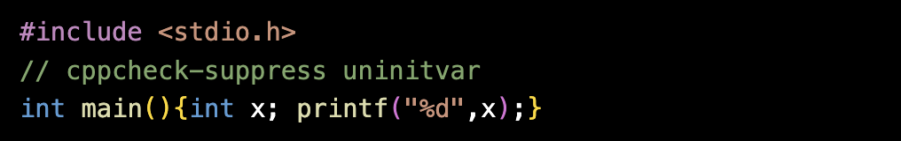

# Cppcheck Official


**Cppcheck Official** is a Visual Studio Code extension that runs [cppcheck](https://cppcheck.sourceforge.io/) against C/C++ files when you open, save or switch to them, and reports any warnings or errors in the Problems panel.


## Features
- **Automatic analysis**: `cppcheck` runs automatically on a C/C++ file when you open it, save it or switch to its tab. See [When analysis runs](#when-analysis-runs).
- **Diagnostics for the analysed file and its headers**: Warnings for the analysed file are shown, together with warnings in the header files it includes (unless a project file is used, in which case only the analysed file's warnings are shown). Critical errors, such as `syntaxError`, are always shown. See [Warnings in header files and critical errors](#warnings-in-header-files-and-critical-errors).
- **Configurable severity threshold**: Filter out messages below a chosen severity level (`info`, `warning`, or `error`). See [Severity filter](#severity-filter).
- **Diagnostic cleanup**: When you close a file, its diagnostics are automatically cleared. Warnings in a header file stay as long as another open file that includes it is still open.
- **Project file support**: You can feed your project file to cppcheck through the `--project` flag in the `cppcheck-official.arguments` field in the extension settings. (See image below)


- **Full analysis**: Analyse every file in your project file at once. See [Full analysis](#full-analysis).
- **Warning notes**: Display notes for warnings when those are available. See [Notes](#notes).
- **Dynamic config**: The extension supports running a script to generate arguments to pass to cppcheck. This can be done by including the command in the argument field wrapped with \@(), e.g. `--suppress=memleak:src/file1.cpp @(bash path/to/script.sh)`. The script is expected to output the argument(s) wrapped with \@(). If the script e.g. creates a project file it should print out as `@(--project=path/to/projectfile.json)`. This output will be spliced into the argument string as such: `--suppress=memleak:src/file1.cpp --project=path/to/projectfile.json`.

- **Warning suppression**: Warnings of a specific type can be suppressed with the `--suppress` flag in the argument field in the extension settings. The extension also supports inline suppression for specific lines of code, simply write `// cppcheck-suppress <warning id>` (see image below). Suppressions can also be added through code actions, either as automatically generated inline suppressions or, if you are using a `.cppcheck` project file, as universal suppressions specified in your project file. Adding suppressions to the project file is not supported for `compile_commands.json` or other project types. See [Working with warnings](#working-with-warnings).


## When analysis runs

The extension analyses one C/C++ file at a time. Analysis runs when:
- You save a C or C++ file.
- You open a C or C++ file.
- You switch to a file's tab.
- You open a file in a preview tab (for example with a single click in the Explorer). Analysis starts after a short delay if you stay on the file. The file's warnings are cleared when you switch to another editor.
- VS Code starts or a workspace folder is added. All open C/C++ files are then analysed.

Analysis is skipped when:
- The file isn't a C or C++ file. The extension uses VS Code's language mode for this, so the file must be shown as `C` or `C++` in the status bar.
- The file isn't visible in any editor.
- The file content hasn't changed since the last successful analysis. The extension forgets the content when the file is closed, so reopening a file analyses it again.
- `cppcheck-official.enable` is `false`. The file's warnings are cleared instead.

Cppcheck analyses the file as it is saved on disk, not the unsaved content in the editor. Warnings for unsaved changes appear after you save the file.

While an analysis runs, the status bar shows **Cppcheck Running**.

## Working with warnings

### Severity filter

The status bar item **Cppcheck severity: …** opens a picker with the levels **Info**, **Warning** and **Error**. Your choice is saved in the workspace setting `cppcheck-official.minSeverity`. It applies right away to the warnings already shown, in all files.

Cppcheck severities map to the levels like this:

| Cppcheck severity | Level |
| --- | --- |
| `error` | Error |
| `warning` | Warning |
| `style`, `performance`, `portability`, `information` | Info |

**Info** shows everything, **Warning** shows warnings and errors, and **Error** shows only errors.

### Code actions

Put the cursor on a line with a cppcheck warning and click the lightbulb or press `Ctrl+.` (`Cmd+.` on macOS). These actions are offered for each warning id on the line:

| Action | What it does | How long it lasts |
| --- | --- | --- |
| **Add comment that suppresses this `<id>` warning** | Inserts `// cppcheck-suppress <id>` above the line and hides the warning right away. For a warning with several locations, the comment is added where cppcheck expects it, which can be a different line or file than the one marked. | Permanent, because the comment is part of your code. |
| **Hide this `<id>` warning** | Hides this one warning. | Until the file is analysed again. |
| **Hide all `<id>` warnings** | Hides every warning with this id, in all files. | Also in later analyses, until VS Code is restarted. |

When warning types are hidden, the status bar shows **Hidden types: N**. Click it and pick a type to show its warnings again.

If you use a `.cppcheck` project file, two more actions are offered. Both add a `<suppression>` to the project file, so they are permanent and are shared with everyone who uses the project file:

- **Suppress warning type `<id>` universally (in project file)**: suppresses the warning id everywhere.
- **Suppress warning `<id>` based on file and / or symbol**: first asks for a file path (leave it blank to not limit the suppression to a file). If the warning has a symbol name, it then asks whether to limit the suppression to that symbol.

A project file suppression takes effect the next time the file is analysed. These two actions aren't available with `compile_commands.json` or other project types.

Code actions aren't offered for a warning if its line has been edited since the analysis. Save the file to analyse it again.

### Other ways to suppress warnings

- **Inline suppressions**: write `// cppcheck-suppress <id>` on the line above the warning, or at the end of the line. This always works, because the extension always passes `--inline-suppr` to cppcheck.
- **Arguments**: add `--suppress=<id>` (or `--suppress=<id>:<file>`) or `--suppressions-list=<file>` to `cppcheck-official.arguments` or `cppcheck.json`.

See the Cppcheck manual ([open source](https://cppcheck.sourceforge.io/manual.pdf#page=19) / [Premium](https://files.cppchecksolutions.com/manual.pdf#page=19)) for the suppression formats.

### Notes

Some warnings have several locations, for example "Either the condition … is redundant or …". The extra locations are shown as notes under the warning in the Problems panel. Click a note to jump to its location.

### Links to checker documentation

For some warning ids, the id in the Problems panel is a link. Click it to open the documentation for the checker, or the SEI CERT C rule that the checker relates to. For Cppcheck Premium `premium-cert-*` warnings, the id links to the matching SEI CERT C rule.

## Warnings in header files and critical errors

Analysing a source file can produce warnings in other files, usually the header files it includes. Whether these warnings are shown depends on whether you use a project file.

### Without a project file

- Warnings in an included header file are shown in the header file, not in the source file that includes it.
- If several open source files produce warnings in the same header file, the header file shows all of them.
- A header file's warnings stay while any source file that produced them is still open. They are cleared when the last of those source files is closed.
- A warning in another file is only shown if VS Code can open that file.

### With a project file

If the arguments contain `--project=…`, only warnings in the analysed file itself are shown. Warnings in other files, including headers, are left out on purpose. Critical errors are the exception.

### Critical errors

Some errors mean that the analysis failed or is incomplete, so the results can't be trusted. Examples are a syntax error (`syntaxError`), a file that can't be found (`missingFile`), and an invalid Cppcheck Premium licence (`premium-invalidLicense`). Other critical errors are about unknown macros, `#error` directives, include nesting that is too deep, and internal cppcheck errors.

Critical errors are always shown:
- even when they are reported in another file,
- even when a project file is used,
- whatever the severity filter is set to.

If a critical error has no valid line number, it is shown on the first line of the file.

## Full analysis

Normally the extension analyses only the files you open. A full analysis runs cppcheck on every file in your project file, and shows the warnings for all of them in the Problems panel, including files you haven't opened.

### When it is available

Full analysis needs a project file, given with `--project=…` in `cppcheck-official.arguments` or in `cppcheck.json`. Both `.cppcheck` project files and `compile_commands.json` work.

The **Full Analysis** button appears in the status bar after a file has been analysed with a project file. It is hidden while an analysis is running.

### Running it

1. Click **Full Analysis** in the status bar.
2. Choose how many threads cppcheck should use: 1, 2 or 4. This sets the cppcheck option `-j1`, `-j2` or `-j4`.

While the analysis runs, the status bar shows **Cppcheck Running**. A full analysis can take a long time on a large project.

### Results

- All existing warnings are cleared before the full analysis starts.
- The severity filter and hidden warning types apply to the results as usual.
- The warnings stay in the Problems panel until the next full analysis, also for files that you never opened. Closing a file doesn't remove its warnings.
- If a warning is in a file that VS Code can't open, it is skipped and an information message "Unable to find location of error [id]: …" is shown.

## Requirements

 **Cppcheck** must be installed on your system.
  - By default, this extension looks for `cppcheck` on the system PATH.
  - Alternatively, specify a custom executable path using the `cppcheck-official.path` setting.


Examples of installing Cppcheck:
  - On Linux (Debian/Ubuntu), install via `sudo apt-get install cppcheck`.
  - On macOS with Homebrew: `brew install cppcheck`.
  - On Windows, install from [cppcheck's website](https://cppcheck.sourceforge.io/).

## Extension Settings

This extension contributes the following settings under `cppcheck-official.*`:

- **`cppcheck-official.enable`**: (boolean) Enable or disable the extension.  
- **`cppcheck-official.minSeverity`**: (string) Minimum severity to report (`info`, `warning`, or `error`).  `info` shows style, performance, portability and information messages.
- **`cppcheck-official.arguments`**: (string) Additional command line arguments to pass to `cppcheck`. See the Cppcheck manual ([open source](https://cppcheck.sourceforge.io/manual.pdf#page=4) / [Premium](https://files.cppchecksolutions.com/manual.pdf#page=4)).  
- **`cppcheck-official.path`**: (string) Path to the `cppcheck` executable (e.g. `/path/to/cppcheck.exe`). If left empty, `cppcheck` from the system PATH is used. Supports paths relative to workspace folder on the formats `./RELATIVE_PATH`, `../RELATIVE_PATH` or `${workspaceFolder}/RELATIVE_PATH`.

## Shared Settings File

To give all developers in a project the same setup, create a `cppcheck.json` file in the root of the workspace folder and commit it to version control:

```json
{
  "arguments": "--project=build/compile_commands.json --enable=style --suppress=missingInclude"
}
```

`arguments` can be either a string or an array of strings. If the file specifies `arguments`, it takes precedence over the `cppcheck-official.arguments` setting. Relative paths are resolved relative to the workspace folder. All other settings are still read from the VS Code settings, so each developer can adjust them individually.

## Reporting Issues
Please submit any issues or feature requests via the [GitHub Issues page](https://github.com/cppchecksolutions/vscode-cppcheck-official/issues).

## Acknowledgements
This plugin is forked from the plugin cppcheck-lite by Justus Rijke (https://github.com/JustusRijke/Cppcheck-Lite).