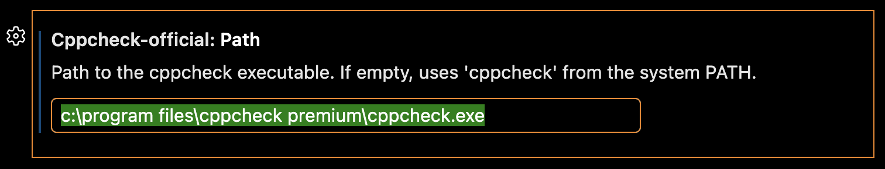

The extension needs cppcheck to be installed. By default it runs `cppcheck` from the system PATH. If that works for you, you can skip this step: click the circle next to the step to mark it as done.

If cppcheck isn't on the PATH, or you want to use another installation, open the extension settings and set the path to the cppcheck executable in the `path` property, e.g. `C:\Program Files\Cppcheck\cppcheck.exe` or `/usr/bin/cppcheck`. Relative paths such as `./tools/cppcheck` or `${workspaceFolder}/tools/cppcheck` are relative to the workspace folder.

[Open the path setting](command:workbench.action.openSettings?%5B%22cppcheck-official.path%22%5D)

[Browse for cppcheck](command:cppcheck-official.browsePath)
