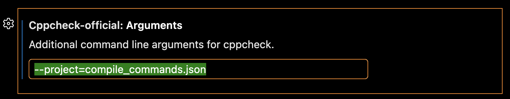

A project file tells cppcheck which files belong to your project and how they are compiled. Add `--project=<file>` to the arguments, e.g. `--project=build/compile_commands.json` or `--project=myproject.cppcheck`. Relative paths are relative to the workspace folder. See the Cppcheck manual ([open source](https://cppcheck.sourceforge.io/manual.pdf#page=10) / [Premium](https://files.cppchecksolutions.com/manual.pdf#page=10)) for how to create a project file.

With a project file:
- Only warnings in the analysed file are shown, apart from critical errors.
- With a `.cppcheck` project file, you can add suppressions to the project file from code actions.
- You can run a full analysis of the whole project.

It's a good idea to use the same project file in VS Code and in your CI workflows, so that both give the same results.

To make sure that you and your team work with the same setup, put the arguments in a `cppcheck.json` file in the root of your workspace and commit it to version control:

```json
{ "arguments": "--project=build/compile_commands.json" }
```

Arguments in this file take precedence over the `arguments` setting. See [Project files](https://github.com/cppchecksolutions/vscode-cppcheck-official#project-files) and [Shared settings file](https://github.com/cppchecksolutions/vscode-cppcheck-official#shared-settings-file) in the README.

[Read about project files](https://github.com/cppchecksolutions/vscode-cppcheck-official#project-files)