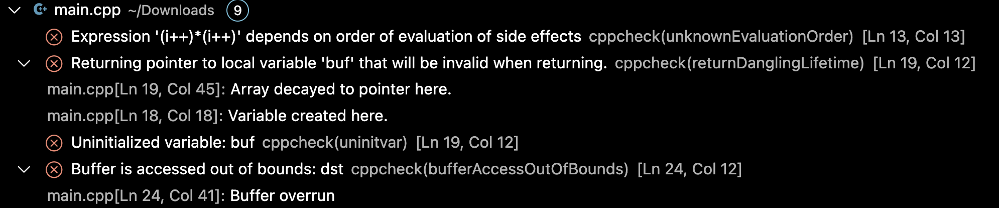

Open a .c or .cpp file. Cppcheck analyses it when it is opened, when you switch to its tab and every time you save it. If cppcheck detects any issues these will show up in the Problems panel at the bottom of your VS Code window.

Cppcheck analyses the file as it is saved on disk, so warnings for unsaved changes appear after you save. See [When analysis runs](https://github.com/cppchecksolutions/vscode-cppcheck-official#when-analysis-runs) in the README.

[Open the Problems panel](command:workbench.actions.view.problems)

The extension is in continuous development, so if you find issues, have feature requests or some other kind of feedback we are happy to receive it at the [Cppcheck Official github page](https://github.com/cppchecksolutions/vscode-cppcheck-official/issues).